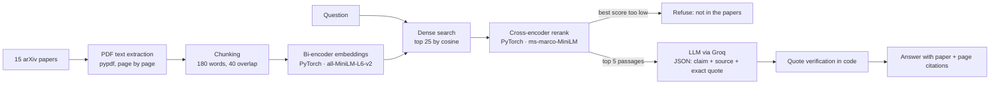

# Research Paper Assistant (RAG with verified citations)

**Live demo:** https://kokkulajyothika-research-paper-rag-assistant-app-gzdu8i.streamlit.app/ (free hosting: if it has been asleep, click "wake up" and wait about a minute)

A retrieval-augmented generation (RAG) app that answers questions about 15 influential AI research papers — Transformers, RAG, ReAct, Self-RAG, RAGAS and more — **with a citation to the paper and page for every claim**.

Built around one idea: **an answer is only shown if it can be traced back to the source.** The model must quote the passage it used; Python code checks every quote against the source text and removes anything it cannot find. If the papers don't contain the answer, the app says so instead of guessing.

## How it works



| Stage | What it does | Why |
|---|---|---|
| **Bi-encoder** (PyTorch, sentence-transformers) | Embeds every chunk once; finds the 25 most similar chunks in milliseconds | Fast semantic search, not just keyword matching |
| **Cross-encoder reranker** (PyTorch) | Reads question and passage together and re-scores the 25 candidates | More accurate ranking than embeddings alone |
| **Refusal guard** | If the best reranker score is below a threshold, no answer is generated | Stops the model answering off-topic questions from its own memory |
| **Cited generation** (Groq, strict JSON schema) | Each claim must name a source number and copy an exact quote | Makes every claim checkable |
| **Quote verification** (Python) | Normalises case, spacing and punctuation, then checks the quote is in the cited passage | Unsupported claims are removed and shown to the user |

## Evaluation

`eval/questions.jsonl` holds 20 questions: 17 answerable (each linked to the paper that answers it) and 3 deliberately off-topic. `python -m eval.evaluate` reports, for the bi-encoder alone and with the reranker:

- **Recall@1 / @3 / @5**: is a passage from the correct paper in the top k?
- **MRR**: mean reciprocal rank of the correct paper
- **Refusal accuracy**: does the guard answer the answerable questions and refuse the off-topic ones?
- **Citation check** (`--answers`): share of generated claims whose quotes were found in the cited source

Results are written to `eval/results.md` (the evaluation downloads the papers and models, so it is run on a machine with internet access).

## Tests

`pytest -q` runs 15 unit tests that need no downloads: chunking, cosine search, reranking order, the refusal threshold, quote verification (including wrong source numbers and fabricated quotes), error handling and the evaluation metrics. Small fake models stand in for the neural networks.

## Run it locally

```bash
pip install -r requirements.txt
export GROQ_API_KEY=your_key_here     # free key from console.groq.com
streamlit run app.py
```

The first run downloads the 15 papers from arXiv and the two models from Hugging Face, then builds the index (a few minutes); later runs load it from `data/`.

## Deploy free on Streamlit Community Cloud

1. Sign in at [share.streamlit.io](https://share.streamlit.io) with GitHub and choose **Create app → Deploy a public app from GitHub**.
2. Pick this repository, branch `main`, main file `app.py`, Python 3.11.
3. Under **Advanced settings → Secrets**, add `GROQ_API_KEY = "your_key"`.
4. Deploy. The first start builds the index, so it takes a few minutes.

## Tech stack

Python · PyTorch · sentence-transformers (bi-encoder + cross-encoder) · NumPy · pypdf · Groq API (LLM with JSON-schema output) · Streamlit · pytest

## Papers

Papers are downloaded from arXiv at run time and are not stored in this repository. The list is in `papers.json`; adding a paper is one line.

## Author

**Jyothika Kokkula** — MSc Artificial Intelligence student
[LinkedIn](https://www.linkedin.com/in/jyothikakokkula) · [GitHub](https://github.com/kokkulajyothika)

Related projects: [AI Job Hunt Agent](https://github.com/kokkulajyothika/AI-Job-Hunt-Agent-n8n) · [AI CV Screening Assistant](https://github.com/kokkulajyothika/AI-CV-Screening-n8n)
